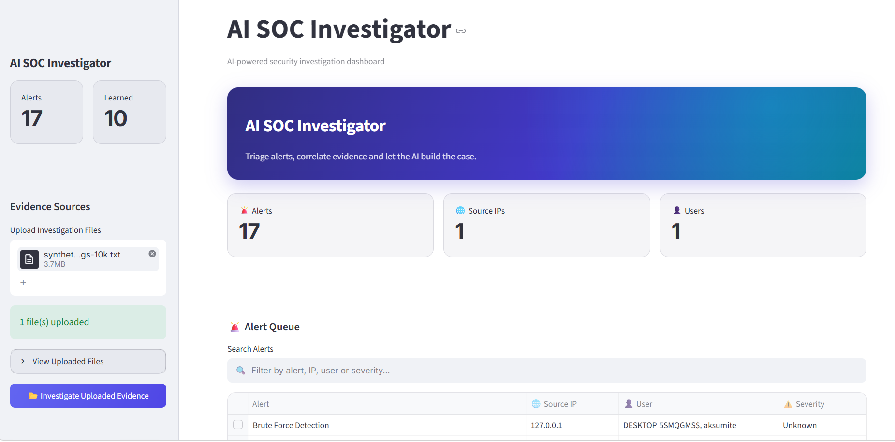
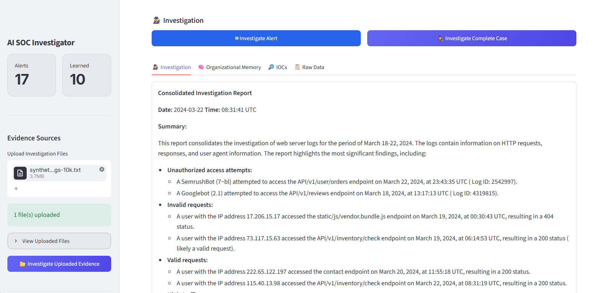
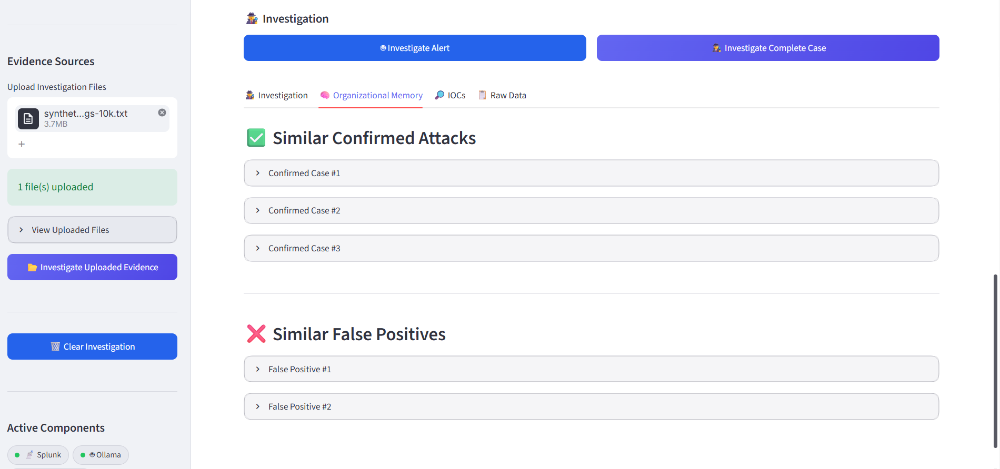
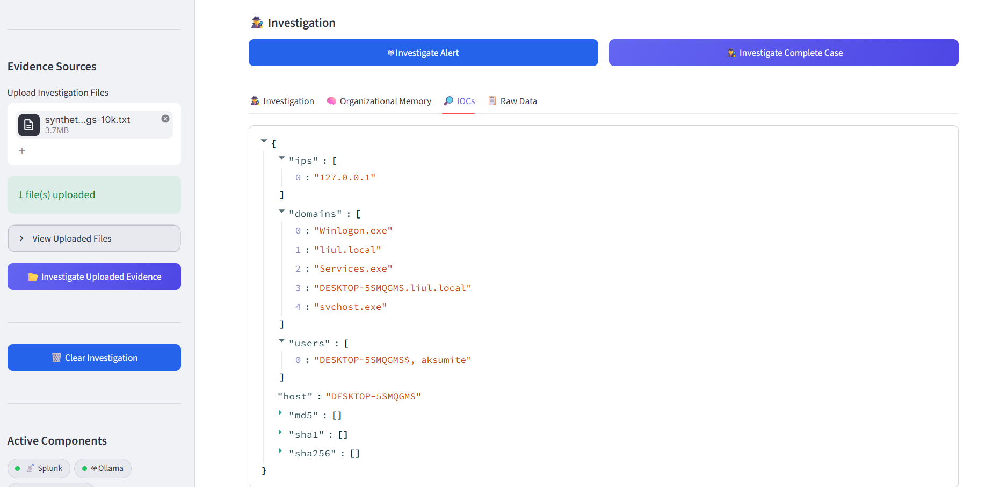
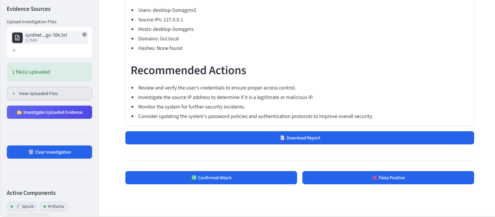

# AI SOC Investigation Platform

An AI-powered Security Operations Center (SOC) investigation platform designed to help analysts investigate security alerts more efficiently.

This project combines AI alert analysis, IOC extraction, event correlation, historical case retrieval, and local LLM capabilities to provide context-driven investigations. The platform also learns from previous analyst decisions, allowing knowledge from confirmed attacks and false positives to be reused in future investigations.

## Why I Built This

Security analysts often spend significant time gathering context from multiple sources before reaching a conclusion. The goal of this project is to streamline that process by automatically analyzing alerts, retrieving relevant historical cases, and generating investigation summaries that can assist decision-making.

This project also explores how AI and retrieval-augmented generation (RAG) can be applied to SOC workflows while keeping analysts in control of the final decision.

---

## Features

- AI Alert investigation workflow
- IOC (Indicator of Compromise) extraction
- Event correlation
- Historical case retrieval
- Analyst feedback learning
- Knowledge base using ChromaDB
- Retrieval-Augmented Generation (RAG)
- Local LLM integration through Ollama
- Investigation summaries and recommendations
- Storage of confirmed attacks and false positives for future reference

---

## Architecture

The investigation process follows these steps:

1. Security alert is received.
2. IOC extraction identifies relevant indicators.
3. Correlation engine gathers additional context.
4. Historical incidents are retrieved from the knowledge base.
5. Relevant context is supplied to the language model.
6. Investigation summary is generated.
7. Analyst reviews the findings.
8. Analyst feedback is stored to improve future investigations.

---

## Technologies Used

### Programming

- Python

### AI & Machine Learning

- Ollama
- Sentence Transformers
- Retrieval-Augmented Generation (RAG)

### Data & Storage

- ChromaDB
- JSON Storage

### User Interface

- Streamlit

## Installation

- Install Ollama

- pip install -r requirements.txt

Start Ollama before running the application.

---

## Running the Application

- python app.py
- streamlit run dashboard.py

The application will open in your browser automatically.

---

## Author

Liul Sintayehu Tebkew

Computer Science Gold Medalist and Cybersecurity Master's Student with interests in cybersecurity, artificial intelligence and enterprise technologies.

This project was built as part of my exploration of applying AI to real-world SOC investigations and security operations workflows.

## Screenshots

### Dashboard

### Investigation Results

### Organizational Memory & Historical Knowledge Retrieval

### IOC Collection

### Analyst Feedback & Report Download

